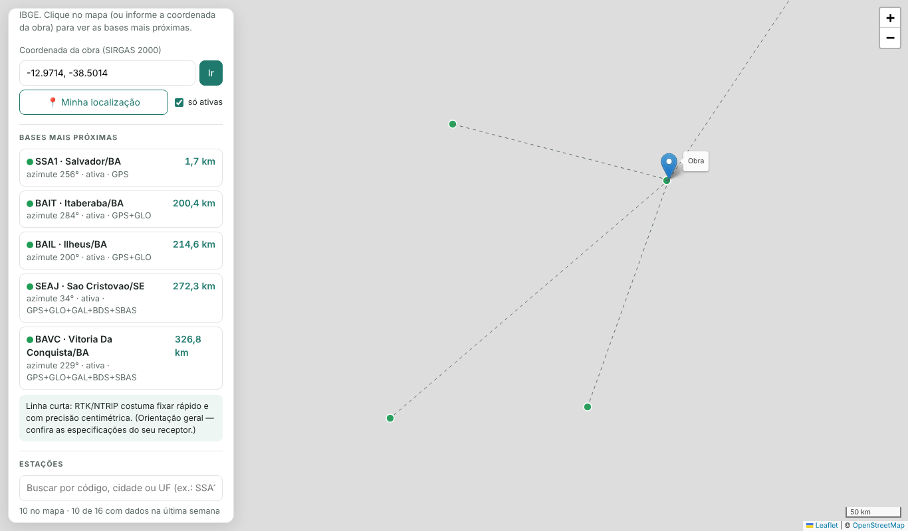

# Mapa da RBMC

[](https://github.com/maessa-oliveira/rbmc-mapa/actions/workflows/ci.yml)
[](https://github.com/maessa-oliveira/rbmc-mapa/actions/workflows/atualizar-dados.yml)
[](https://maessa-oliveira.github.io/rbmc-mapa/)
[](LICENSE)

**Qual a base RBMC mais perto da sua obra — e ela está funcionando?**
Mapa das estações da Rede Brasileira de Monitoramento Contínuo (RBMC/IBGE) com a situação de
cada estação na última semana, distância e azimute até a obra e uma orientação prática para
RTK/NTRIP ou pós-processamento.

👉 **[Abrir o mapa](https://maessa-oliveira.github.io/rbmc-mapa/)**



> 🇬🇧 *Interactive map of Brazil's continuous GNSS reference network (RBMC/IBGE). Shows which
> stations published data in the last 7 days, the nearest bases to a job site (Vincenty distance
> and azimuth on GRS80) and practical guidance for RTK vs. post-processing. Data refreshed daily by
> a GitHub Actions pipeline.*

## Como funciona

```
 GitHub Actions (todo dia 06:17)                                 GitHub Pages
 ┌───────────────────────────────┐   data/rbmc.json   ┌──────────────────────────────┐
 │ scripts/atualizar_rbmc.py     │ ─────────────────► │ index.html + Leaflet         │
 │  • site logs IGS do IBGE      │   commit automático│  • situação de cada estação  │
 │    (coordenadas, receptor)    │                    │  • 5 bases mais próximas     │
 │  • arquivos diários de dados  │                    │  • distância/azimute (GRS80) │
 │    (estação ativa ou não)     │                    │  • orientação RTK x estático │
 └───────────────────────────────┘                    └──────────────────────────────┘
```

- **Coordenadas, receptor, antena e constelações** vêm dos *site logs* (formato IGS) publicados pelo IBGE.
- **Situação**: a estação é "ativa" quando há arquivo de observação publicado em pelo menos 6 dos últimos 7 dias,
  "instável" com menos dias e "sem dados recentes" quando não há nenhum.
- **Distância e azimute**: problema inverso de Vincenty no elipsoide GRS 80 (SIRGAS 2000), com precisão sub-milimétrica.
- Sem servidor e sem custo: o site é estático e os dados são atualizados pelo próprio GitHub.

## Uso

- Clique no mapa, use **Minha localização** ou digite a coordenada (`-12.9714, -38.5014` ou `12°58'17"S 38°30'05"W`).
- Filtre por código, cidade ou UF. O link `?obra=-12.97,-38.50` abre já com a obra marcada.

> A orientação por distância é uma regra prática. A precisão real depende do receptor, das frequências,
> da ionosfera e do tempo de rastreio — confira sempre em ponto conhecido.

## Desenvolvimento

```bash
npm install
npm test            # geodésia (node --test) + atualizador com servidor simulado (pytest)
npm run test:e2e    # Chromium (Playwright): busca, filtros e erros, em desktop e celular
python3 scripts/atualizar_rbmc.py   # baixa os dados reais do IBGE
```

## Dados e créditos

Dados públicos do **IBGE — RBMC** ([página oficial](https://www.ibge.gov.br/geociencias/informacoes-sobre-posicionamento-geodesico/rede-geodesica/16258-rede-brasileira-de-monitoramento-continuo-dos-sistemas-gnss-rbmc.html)).
Projeto independente, sem vínculo com o IBGE. Mapa base © colaboradores do OpenStreetMap; Leaflet (BSD-2).

## Autora

**Maessa Oliveira** — agrimensora e projetista, graduanda em Engenharia de Software.
[LinkedIn](https://www.linkedin.com/in/maessa-oliveira/) · Licença [MIT](LICENSE).

## English

**Map of Brazil's RBMC GNSS reference network (IBGE).** Shows each station's status over the last
week, finds the nearest stations to your job site (Vincenty distance and azimuth on GRS80) and gives
practical guidance for RTK, NTRIP or static post-processing. Data is refreshed daily by GitHub
Actions from IBGE's public site logs and observation listings.

👉 [Try it](https://maessa-oliveira.github.io/rbmc-mapa/) · `pytest` (updater) · `node --test` (geometry)
